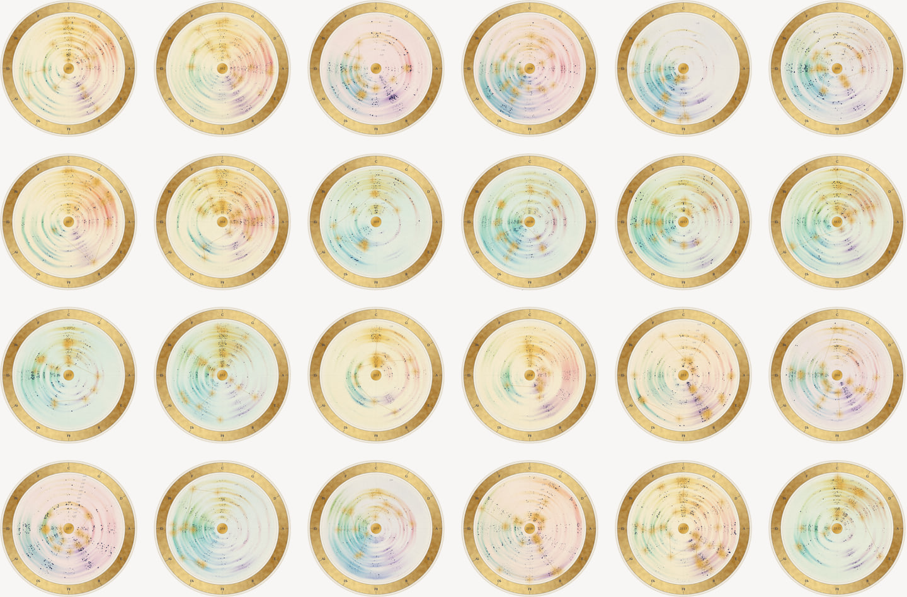
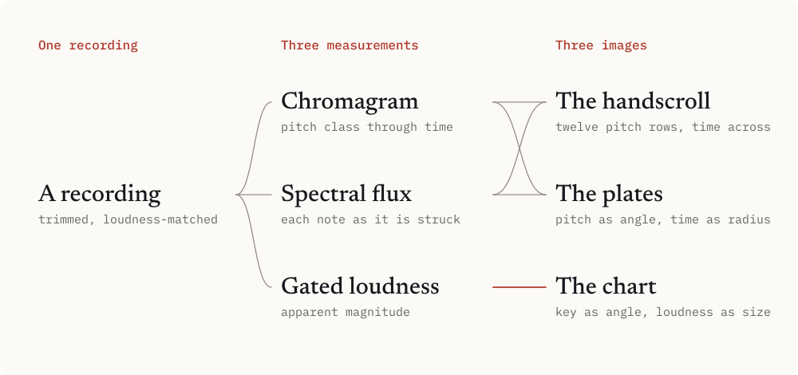
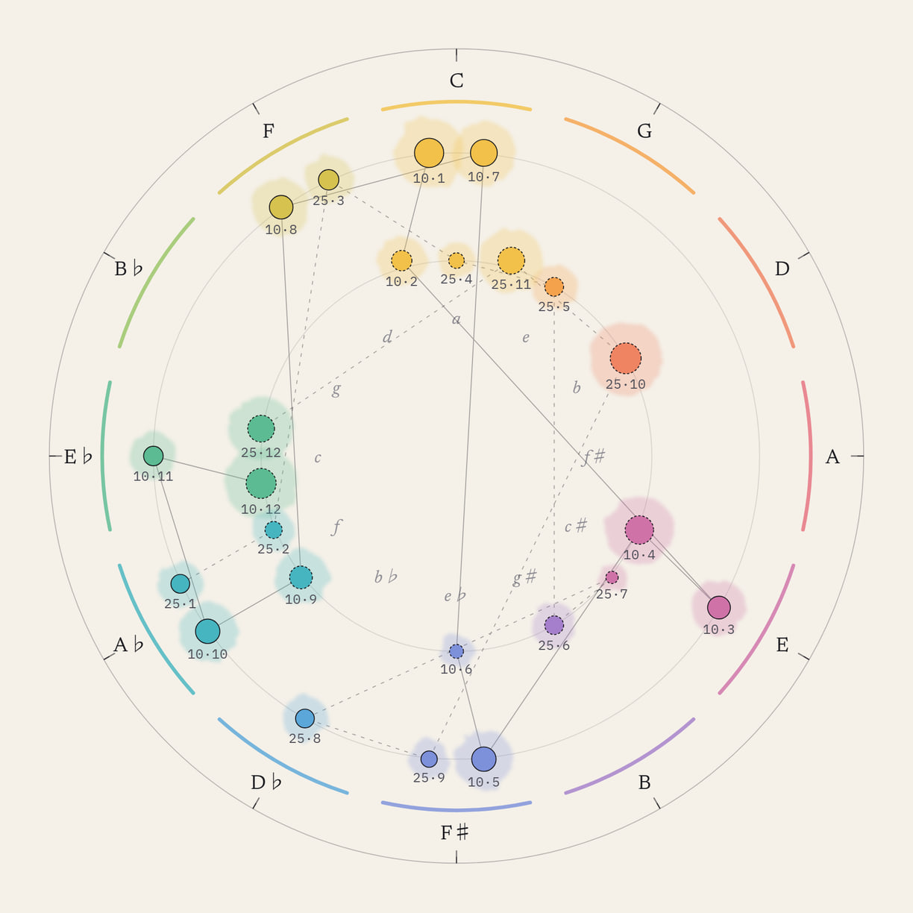
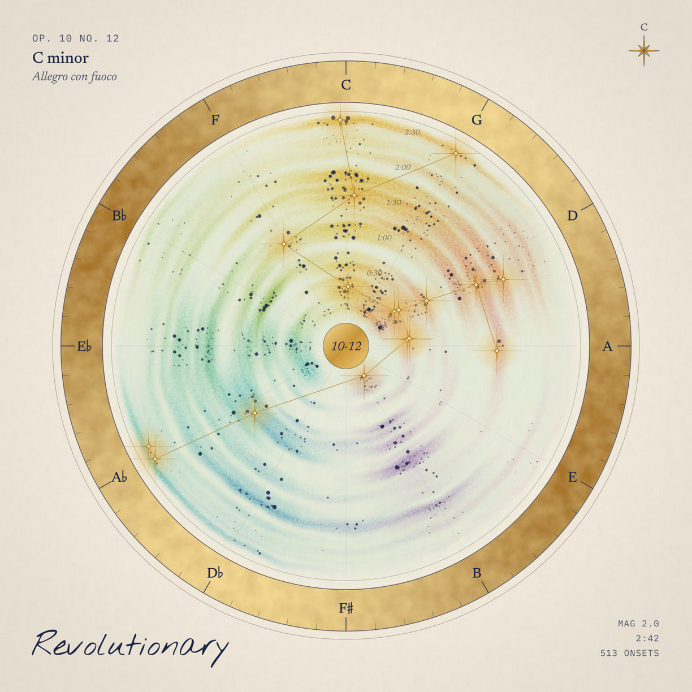
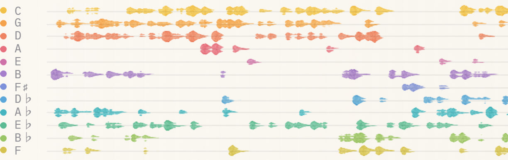

# The Étude Sky

> “Nature always wears the colors of the spirit.”
>
> Ralph Waldo Emerson, *Nature* (1836)

**Chopin’s twenty-four études, charted as stars on the circle of fifths. Every mark is computed from the music.**

**[View the sky](https://www.theodoreoy.com/etude-sky/)**

When I look up at the night sky, I think of Chopin’s études. This is the picture that forms in my mind: each étude a star, placed by its key, and each a plate drawn from the music itself. Someone else, looking up, would see another sky.

## The constraint

I allowed myself no decorative invention. Each recording is analysed once, and the chart, the plates and the handscroll are drawn from that analysis by fixed rules, so every stroke on the page can be traced back to a sound.

## Music, read as astronomy

The chart borrows its method from real star catalogues and its geometry from harmony, so a listener who knows either can read the other.

| In the music | In the sky |
|---|---|
| Key on the circle of fifths | Position angle: C at 0°, each fifth 30° clockwise |
| Major, or its relative minor | Outer ring, or inner ring at the same angle |
| Gated loudness of the recording | Apparent magnitude on Pogson’s scale, one magnitude to 4 dB |
| Études that share a key | Multiple stars: a triple in A minor and seven doubles |
| Order of publication | Two asterisms: Op. 10 solid, Op. 25 dashed |

Fifteen keys hold all twenty-four études. Drawn this way, the two books show a difference the ear learns slowly: Op. 10 is built mostly from pairs in relative keys, while Op. 25 moves more often by a third.

## The plates

Each plate is one polar plot inside a gilded astrolabe ring. Position angle is pitch class on the circle of fifths, distance from the centre is time, and every point is a note as it is struck, sized by its strength. Each pitch class keeps its colour from the wheel, laid where and when it sounds, and gold joins the strongest notes in a minimum spanning tree. One set of rules draws all twenty-four, so their differences are differences in the music.

<em>Op. 10 No. 12 in C minor, “Revolutionary”: 513 onsets over 2:42 at magnitude 2.0.</em>

## The handscroll

Beneath the chart, each étude is written out as a handscroll. Its twelve rows are the circle of fifths laid flat, and time runs from left to right. Every note is a stroke of watercolour in the colour of its pitch, pressed where the key is struck and thinning as the string dies away, with pigments that mix by the Beer–Lambert law. A key reads as a band of neighbouring rows, and a change of key as that band moving.

## The listening

The scroll unrolls with the music, so each stroke appears as its note sounds, and what is still to come shows faintly, like the underdrawing in a copybook. Two decks crossfade, so one étude hands over to the next without a gap, and the full cycle runs 62 minutes. The paper is laid by the true solar time at which you arrive, so no two visits are painted quite alike.

## Credits

Curated by Theodore Ouyang. Recordings by Edward Neeman for Musopen’s *Set Chopin Free* (2014), public domain, trimmed and loudness-matched. Type: Nothing You Could Do, Newsreader and IBM Plex Mono.
